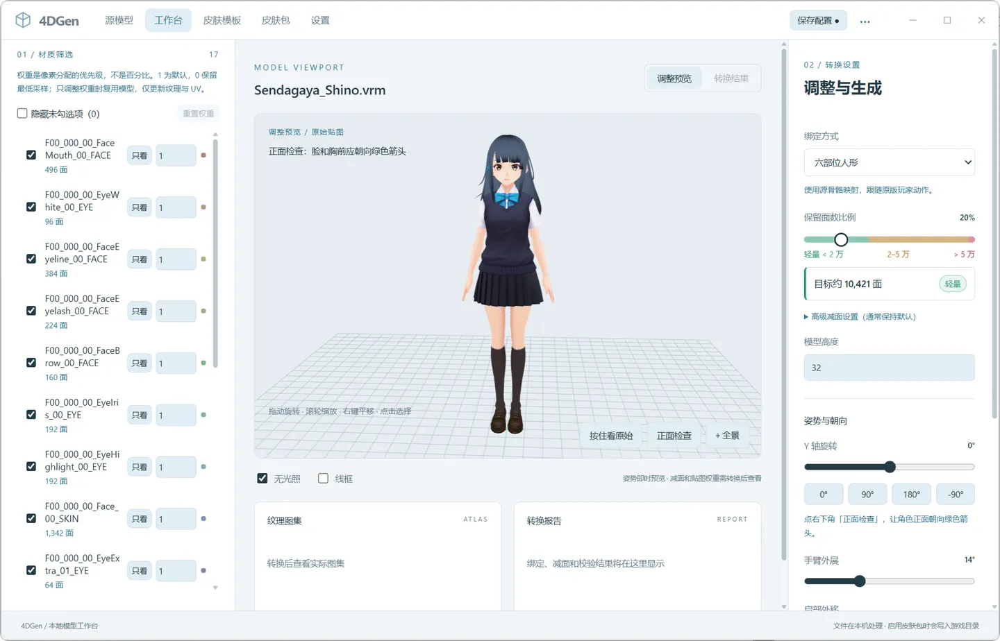

# 4DGen

[](https://github.com/XiaoYangx666/MCBE-4DGen/actions/workflows/ci.yml)
[](LICENSE)
[](#交流群)

把 PMX、VRM、FBX、GLB、OBJ 等 3D 模型或一张图片，转换成 **Minecraft Bedrock 4D 皮肤包**。



*工作台：导入模型后调整材质、减面、姿势，并生成 4D 皮肤包。*

## 快速开始

### 网页版（无需安装）

直接打开：<https://4dgen.mcxfj.top>

图片皮肤和 3D 模型转换都在浏览器里完成，文件不会上传。支持 GLB / glTF / VRM / OBJ / PMX 等模型，生成后直接下载 `.zip` 皮肤包。手机也可以使用。

### Windows 桌面版

从 [Releases](https://github.com/XiaoYangx666/MCBE-4DGen/releases/latest) 下载最新版本：

- `4DGen-0.1.0-setup.exe`：安装版，中文安装界面，按当前用户安装，不需要管理员权限
- 便携版 ZIP：解压后直接运行 `4DGen.exe`

安装包和便携版都不需要另装 Node.js。当前构建未签名，首次运行可能触发 Windows SmartScreen 提示。

桌面版支持本地模型库、人形绑定、材质筛选、多皮肤包管理和写入游戏目录；网页版更轻量，适合快速生成和手机使用。

## 使用流程

1. **导入模型**：源模型 → 导入模型 → 选择模型、文件夹或 ZIP → 继续编辑。
2. **调整与预览**：在工作台筛选材质、调整姿势、减面、高度和贴图参数。
3. **生成皮肤包**：保存皮肤，选择要保留的条目。
4. **写入游戏（可选）**：先在设置里配置 Minecraft 的 `skin_packs` 目录，再到皮肤包页启用；启用前会自动备份。

只做图片皮肤时，跳过第 1 步：皮肤模板 → 图片 · 平面皮肤 → 选择图片 → 生成。

默认不会写游戏目录。只有显式执行「启用」或给 workflow 加 `--deploy` 才会写入。

## 从源码运行

需要 Node.js 24+。

```sh
git clone https://github.com/XiaoYangx666/MCBE-4DGen.git
cd MCBE-4DGen
npm ci
npm run dev
```

打开 <http://127.0.0.1:4173>。

### 纯浏览器网页版（开发）

```sh
npm run webapp:dev      # http://127.0.0.1:4174
npm run webapp:build    # 输出到 webapp/dist/
```

网页版不需要 Node 后台，包含图片皮肤、模型转换（含浏览器内 PMX → GLB）、六部位人形绑定、三维预览、模型站点目录、单包管理和平铺 `.zip` 导出；不写入游戏目录，也没有模型库。贴图固定 128 × 128。

## 功能

- **模型导入**：OBJ/MTL、GLB、glTF、FBX、DAE、STL、PLY、PMX、VRM，保留节点、材质、蒙皮与贴图。
- **优化**：误差受限减面、贴图缩放、显式图集、初始姿态冻结。
- **绑定**：Static 整体绑定；VRM / 常见 MMD / Mixamo 六部位刚性人形绑定（网页版也会自动识别），可调肩宽与手臂外展。
- **导出**：Bedrock `poly_mesh` 几何、ZIP、`manifest.json`、`skins.json`、`geometry.json` 与本地化文件。
- **皮肤包管理**：桌面版支持多包启停、改名、备份与恢复、外部改动保护，写入游戏目录前自动备份；网页版只保留一个浏览器本地包，可持续添加、导入 ZIP 和导出 ZIP。
- **图片模板**：任意可解码图片可生成双面平面 4D 皮肤。
- **界面**：本地 Web 工作台（三维预览、材质筛选、姿势与减面）、Windows 便携版，以及纯浏览器网页版；两端提供构建号与更新日志（设置 / 关于页）。

## 支持格式

| 输入 | 状态 |
| --- | --- |
| OBJ / MTL | 支持 |
| GLB / glTF | 支持 |
| FBX / DAE / STL / PLY | 支持（libassimp；以自建夹具验证导入与静态转换，FBX 复杂角色与人形绑定未验证） |
| PMX 2.0 / 2.1 | 支持（需显式 profile `boneMap`；已在真实 PMX 样本上验证） |
| VRM 0.x | 支持（Static 或人形绑定；有真实样本） |
| VRM 1.0 | 部分支持（仅夹具验证，暂无真实样本） |
| PMD / Blend | 不支持 |

## 文档

- [完整工作流程](docs/workflow.md)
- [本地网页工作台](docs/local-web.md)
- [网页版（纯浏览器）](docs/web-app.md)
- [桌面版使用与打包](docs/desktop.md)
- [数据目录与图片模板](docs/storage-and-templates.md)
- [命令行与皮肤包管理](docs/cli.md)
- [全部文档](docs/README.md)

## 已知限制

- 人形绑定是六部位刚性绑定，不支持平滑蒙皮、肘膝独立弯曲、手指动画或头发/裙摆物理。
- Static 模式冻结初始姿态，模型整体跟随身体，不随四肢独立运动。
- PMD、Blend、KTX2/Basis/Draco 暂不支持。
- 外部贴图只能位于模型文件所在目录及其子目录。
- 网页版只保留一个浏览器本地皮肤包，导入仅支持 `1.8.0` legacy poly_mesh 皮肤包；内置人形与 cube 几何会跳过。
- 安装版和便携版均未签名，首次运行可能触发 Windows SmartScreen。

## 交流群

QQ 群：**1004513100**

## 开发

命令行与皮肤包管理见 [docs/cli.md](docs/cli.md)；开发、测试和桌面版打包见 [docs/development.md](docs/development.md)。

## 许可证

[GNU General Public License v3.0](LICENSE)，SPDX 标识为 `GPL-3.0-only`。
