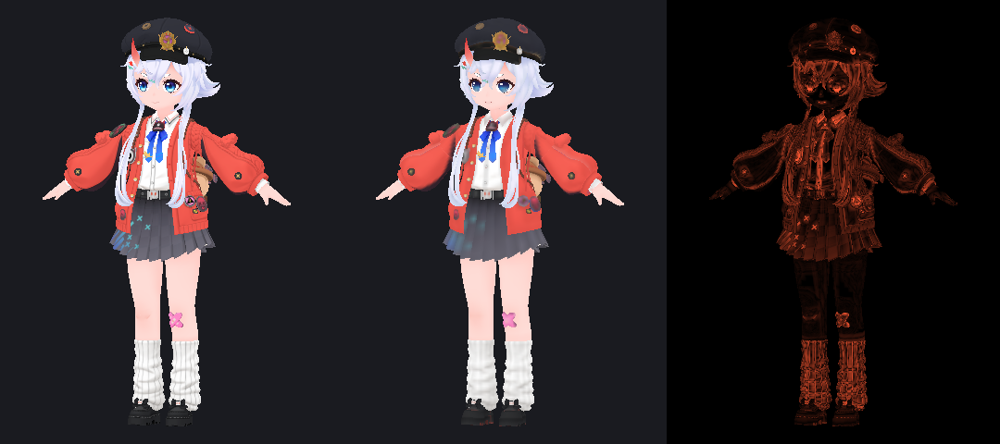
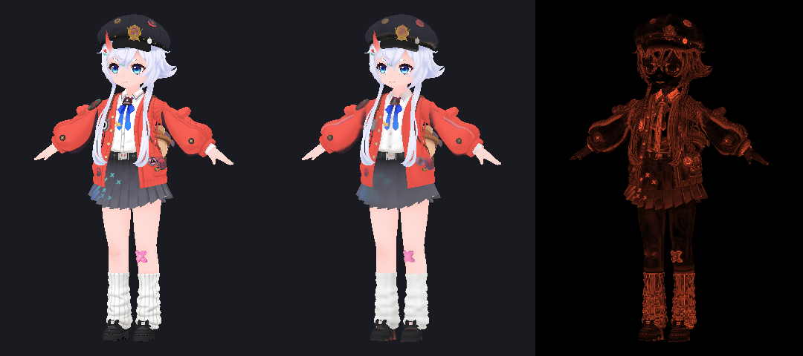
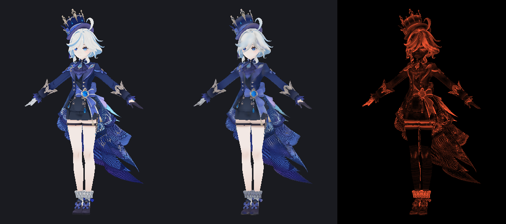
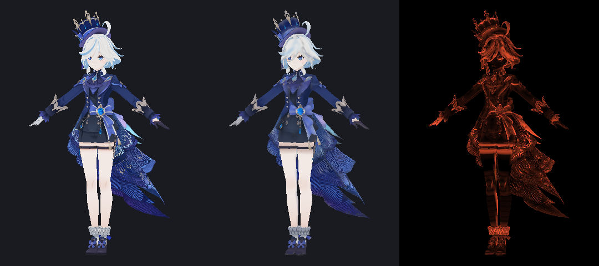

# 第三阶段：候选实现与 A/B 实验

> 分支 `research/texture-allocation-v2`
> 运行：`node scripts/research/atlas/run-stage3.ts`（合成 11 场景 + 6 个真实角色）
> 固定视角：`node scripts/research/atlas/run-views.ts`
> 数据：`data/stage3-models.md`、`data/stage3-control.md`、`data/stage3-deletion.md`、`data/stage3-summary.json`

## 1. 实验设置

六个方案，同一输入、同一 128×128 约束、同一 CPU 渲染器与同一测量：

| 方案 | 预算 | 共享 | 稀疏需求 |
|---|---|---|---|
| `baseline-web` | 生产 `(area·w)^0.85` | 无 | 包围盒 |
| `baseline-desktop` | 生产 `(area·w)^0.85` + crop | UV 重叠/拼接即合并 | crop ±1 texel |
| `A-density` | `targetArea ∝ w²·S` | 无 | 包围盒 |
| `A-retention` | `targetArea ∝ w·T`（T=采样的源纹素数） | 无 | 包围盒 |
| `B-retention-safe` | 同 A-retention | 仅「源像素完全相同」的岛共用矩形 | 包围盒 |
| `C-retention-cov` | 同 A-retention | 无 | 实际采样 UV 面积 |

A/B/C 全部去掉 crop，直接按连续 UV 包围盒映射；装箱使用同一 MaxRects
（4 种排序 + ±10% 长宽微调），预算与装箱在同一个二分搜索内（与生产行为一致）。

## 2. 图集空间

真实模型（`content` = 去 gutter 矩形，`allocated` = 含 gutter，`UV` = 三角面覆盖）：

| 模型 | 方案 | content | allocated | UV 覆盖 | gutter px | 空 px |
|---|---|---|---|---|---|---|
| shino | web | 83.2% | 95.9% | 58.3% | 2086 | 667 |
| shino | desktop | 78.5% | 96.6% | 55.7% | 2964 | 559 |
| shino | A-retention | 84.3% | **97.2%** | **58.7%** | 2126 | 452 |
| shino | C | 83.9% | 97.0% | **59.8%** | 2158 | 488 |
| mingyin | web | 80.1% | 94.8% | 49.1% | 2424 | 844 |
| mingyin | A-retention | 81.3% | **97.2%** | 50.6% | 2612 | 457 |
| mingyin | C | 79.7% | 96.9% | **54.1%** | 2814 | 511 |
| girl | web | 76.8% | 95.2% | 45.4% | 3006 | 787 |
| girl | A-retention | 78.9% | 97.2% | 50.1% | 3006 | 454 |
| girl | C | 79.5% | 97.0% | **53.8%** | 2874 | 484 |
| nana | web | 75.2% | 94.7% | 50.6% | 3196 | 862 |
| nana | desktop | 77.9% | 90.3% | 54.9% | 2040 | 1584 |
| nana | C | **79.8%** | 97.8% | 52.7% | 2948 | **358** |
| lumine | web | 79.6% | 96.2% | 44.5% | 2716 | 625 |
| lumine | C | 82.4% | 97.7% | **48.3%** | 2504 | 372 |
| furina | web | 75.8% | 96.7% | 40.2% | 3416 | 544 |
| furina | desktop | 76.8% | 90.4% | **52.4%** | 2224 | 1579 |
| furina | A-retention | 78.3% | 97.3% | **34.8%** | 3118 | 441 |

观察：

1. **候选方案的装箱效率更高**：`allocated` 稳定在 96.4%～97.8%，
   而生产桌面端在 89%～96.6%（`furina` 只有 90.4%），网页端 94.7%～96.7%。
   原因是候选把装箱放进预算搜索，并按实际可行性收缩，而不是先定面积再祈祷装箱成功。
2. **更高的 allocated 不等于更高的 UV 覆盖**：`furina` 的 web `allocated` 96.7%
   但 UV 只有 40.2%；A-retention `allocated` 97.3% 但 UV 只有 34.8%。
   这是预算把像素集中到少数大 UV 岛、其余岛变成 floor 的结果。
   **不能把 allocated utilization 当优化目标**，这一点在真实模型上再次确认。
3. **C 的 UV 覆盖最稳定**：6 个模型中 5 个高于 web，平均 +4.2 个百分点；
   代价是稀疏材质的自有分辨率（见第 4 节）。

## 3. 权重控制

完整表见 `data/stage3-control.md`。`exp` 是 log(实际密度倍数)/log(权重)；
面积密度 ∝ w² 时理想值为 2.0（即线性密度 ∝ w），`0.00` 表示完全无响应。

| 模型 | 方案 | 目标 | 0.25× | 1× | 4× | exp(4×) |
|---|---|---|---|---|---|---|
| shino | web | Face | 0.33 | 1.00 | 2.82 | 0.75 |
| shino | web | Eyebrow | **1.00** | 1.00 | 1.31 | 0.19 |
| shino | desktop | Eyebrow | **1.00** | 1.00 | **1.00** | 0.00 |
| shino | A-density | Face | 0.06 | 1.00 | 9.28 | 1.61 |
| shino | A-retention | Face | 0.26 | 1.00 | 2.92 | 0.77 |
| shino | A-retention | Eyebrow | 0.60 | 1.00 | 2.03 | 0.51 |
| mingyin | web | 服1 | 0.35 | 1.00 | 2.00 | 0.50 |
| mingyin | desktop | 肌1 | **0.93** | 1.00 | 1.36 | 0.22 |
| mingyin | A-retention | 肌1 | 0.45 | 1.00 | 3.17 | 0.83 |
| shared-texture（合成） | desktop | Face | **1.00** | 1.00 | **1.00** | 0.00 |
| shared-texture（合成） | A-retention | Face | 0.33 | 1.00 | 4.00 | 1.00 |

结论：

1. **生产桌面端存在完全失效**：合并后的区域（`shared-texture`）以及
   被 floor/量化卡住的材质（`Eyebrow`）对 0.25×～4× 完全不响应。
2. **网页版有死区**：0.25× 与 1× 得到相同密度（`Eyebrow` 1.00×）。
3. **候选方案没有死区**（除 floor-bound 材质），响应单调且可预测；
   但绝对倍数被固定预算阻尼：4× 权重通常得到 2～3× 密度，而不是 4×。
   这是正确的物理约束，UI 必须如实说明。
4. `A-density` 的响应最强（Face 4× → 9.28× 面积密度），因为它按密度平方分配；
   这也意味着它更容易「抢走」别人的空间。
5. **floor 是硬上限**：6 个真实模型中 9～31 个岛处于 3×3 最小尺寸
   （`nana` 31/73、`furina` 22/81）。对这些材质提高权重不会生效，
   必须减少材质数量或增大图集。

## 4. 真实视觉质量

### 4.1 逐材质采样误差（源采样为参考）

`密度/误差`：前者是该材质的纹理密度（atlas texels / m²），后者是三角面内
重心采样点与原始源纹理采样的线性 RGB 平均绝对差。

| 模型 | 材质 | 基线 web | 基线桌面 | A-retention | C |
|---|---|---|---|---|---|
| shino | Face | 1768 / 0.0229 | 1730 / 0.0250 | **3835 / 0.0199** | 3354 / 0.0207 |
| shino | Eye | 3626 / 0.1375 | 3591 / 0.1380 | **129517 / 0.0152** | 110737 / 0.0187 |
| shino | Hair_Back | 1671 / 0.0626 | 1715 / 0.0621 | **3453 / 0.0520** | 2867 / 0.0551 |
| shino | Cloth2 | **2168 / 0.0679** | 2204 / 0.0669 | 1417 / 0.0781 | 1852 / 0.0716 |
| nana | Face | 1618 / 0.0557 | 2094 / 0.0528 | **13888 / 0.0366** | 14386 / 0.0371 |
| nana | Eye | 4054 / 0.1409 | 5021 / 0.1395 | **351373 / 0.0274** | 356778 / 0.0256 |
| nana | Cloth2 | 1259 / 0.0424 | **1650 / 0.0377** | 866 / 0.0446 | 1038 / 0.0450 |
| furina | 颜 | 1965 / 0.0598 | 2629 / 0.0498 | **19591 / 0.0304** | 23783 / 0.0274 |
| furina | 髮 | 1028 / 0.1368 | 2099 / 0.1078 | 1558 / **0.1152** | 1153 / 0.1289 |
| furina | 体 | 1120 / 0.1004 | **4011 / 0.0642** | 1754 / 0.0835 | 1180 / 0.0960 |

- retention 对**细节材质**的效果非常大且一致：眼睛误差下降 81%～89%，
  面部下降 13%～49%，头发下降 8%～16%。
- 代价集中在**大面积材质**：`shino` Cloth2 误差 +15%，`nana` Cloth2 +5%。
- 因此「平均误差」是误导性的：它按三角面数量加权，天然偏向大材质。
  质量结论必须逐材质看，并允许用户用权重决定取舍。

### 4.2 固定视角渲染对照

同一几何、同一正交相机、同一 footprint 过滤；参考图直接用原始源纹理采样，
候选图用 128² 图集采样。三栏依次为：参考 / 候选 / 差异。

| 模型 | web | desktop | A-retention | C |
|---|---|---|---|---|
| shino | **0.0270** | 0.0281 | 0.0302 | 0.0275 |
| nana | 0.0294 | **0.0280** | 0.0315 | 0.0321 |
| furina | 0.0438 | **0.0358** | 0.0432 | 0.0422 |

**结论与预期相反**：在默认权重下，retention 的整图误差比基线略差（+3%～12%）。
原因是屏幕面积近似正比于世界面积，而基线正是按世界面积分配；
把像素挪给眼睛/面部，必然让占据大部分屏幕的服装变糊。
`furina` 是例外（桌面端之外的最好结果），因为它的基线把面部压得过低。

这不是「新算法更好」的证据，而是**用户权重必要性的证据**：
如果用户希望面部更清晰，就应显式提高面部权重（此时候选的线性响应才有意义）；
算法不应替用户假设「脸更重要」。

### 4.3 合成角色的直观对照

`character` 场景（面部/眼睛/头发/服装）：

| 方案 | UV 覆盖 | 平均误差 | Face 误差 |
|---|---|---|---|
| web | 68.3% | 0.0332 | - |
| desktop | 66.9% | 0.0315 | - |
| A-retention | 67.6% | **0.0289** | - |
| C | 67.6% | **0.0289** | - |

在该场景中 retention 同时提高了覆盖率和误差，因为它把像素从面积最大但细节最少的
Hair（8 条 0.3 m² 的条带）转移给了面部。

## 5. 部件/材质删除

完整表见 `data/stage3-deletion.md`。删除一个材质批次后重新规划：

| 场景 | 方案 | 删除 | 保留材质平均密度 | UV 变化 | 平均误差 |
|---|---|---|---|---|---|
| part-deletion（合成） | A-retention | Prop | 4 650 → 15 880（**3.41×**） | 56.8% → 96.9% | 0.0298 → 0.0218 |
| shino | A-retention | Cloth2 | 21 116 → 23 713（1.12×） | 58.7% → 56.0% | 0.0587 → 0.0526 |
| nana | A-retention | Cloth2 | 59 751 → 68 298（1.14×） | 51.8% → 48.1% | 0.0443 → 0.0418 |
| lumine | C | 衣 | 13 533 → 16 690（1.23×） | 48.3% → 49.8% | 0.0700 → 0.0564 |
| furina | baseline-desktop | 体2 | 3 206 → 3 232（1.01×） | 52.4% → 49.5% | 0.0723 → 0.0691 |

- 删除后，剩余材质的密度**只会上升或不变**（1.01×～1.23×；两材质合成场景为 3.41×），
  说明需求确实被回收。
- 平均误差下降有一部分是「被删材质本身误差较高」造成的统计假象，
  不能直接当作质量提升。为此做了逐材质核对（`check-deletion.ts`，shino 删除 Cloth2）：

| 结果 | 数量 |
|---|---|
| 保留材质误差改善（< -0.001） | 7 |
| 基本不变（±0.001） | 6 |
| 变差（> +0.001） | 3，最大 +0.0033 |

  即删除不会破坏仍被引用的 UV；少数材质因重新分配而轻微波动。
- **无法验证的情况**：同一材质被多个部件共用时，现有批次结构无法只删除一个部件。
  本轮没有绕过这一点（不修改几何保留语义），因此「部件级删除」仍是一个
  **需要新增 primitive 级归属** 才能支持的能力。

## 6. 正确性与边界

| 场景 | 关注点 | 结果 |
|---|---|---|
| `wrap-modes` (repeat/clamp/mirror) | 跨缝/负 UV | 所有方案无越界、无 NaN；误差 0.1401～0.1500，候选与基线同量级 |
| `degenerate` | 零面积三角/UV | 无崩溃；零 UV 面积三角被计为 1 个采样像素，不放大需求 |
| `tiny-islands` | 40 个亚像素岛 | **桌面端 UV 覆盖 0.4%**；候选 72.1%～72.5%，误差 0.0005（桌面 0.0027） |
| `sparse-island` | 3.8% 覆盖的斜带 | 所有方案都浪费（96% 矩形空白）；C 也无效（单岛时无差别） |
| `overlapping-uv` | 同 UV 不同贴图 | 未错误共享；两材质各自保留矩形 |
| UV 越界 | 所有真实模型 | 所有方案 0 个越界顶点、0 个越出自身矩形（1px 容差） |
| 退化三角 | 所有方案 | 候选 0 个；`baseline-web` 在 nana 有 2 个源面积>0 而图集面积≈0 的退化映射 |

`tiny-islands` 是候选方案最明确的正确性/效率胜利：
去掉 crop 的 ±1 texel 量化后，亚像素岛的映射不再被放大到整块矩形。

## 7. 性能

规划耗时（不含绘制/测量，128×128，单线程 Node）：

| 模型 | web | desktop | A-density | A-retention | C |
|---|---|---|---|---|---|
| shino | 73 ms | 79 ms | 81 ms | 72 ms | 59 ms |
| mingyin | 102 ms | 127 ms | 114 ms | 115 ms | 111 ms |
| girl | 127 ms | 114 ms | 123 ms | 105 ms | 101 ms |
| nana | 94 ms | 75 ms | 96 ms | 85 ms | 94 ms |
| lumine | 36 ms | 26 ms | 31 ms | 41 ms | 33 ms |
| furina | 65 ms | 45 ms | 76 ms | 72 ms | 69 ms |

候选与生产同量级（±40%），没有数量级开销。生产端完整转换（含 sharp 解码/编码）
为 302～602 ms、峰值 RSS 287～604 MB（第一阶段）。

## 8. 结论

1. **已确认**：权重在现有实现中不可靠（合并时 0.00 响应、小材质死区、
   大材质被 0.85 次幂压缩）；跨材质合并是根因之一。
2. **已确认**：包围盒/裁剪浪费显著；去掉 crop 后亚像素岛从 0.4% 提升到 72%。
3. **已确认**：候选能把装箱利用率稳定提高到 97%，并让权重单调可预测。
4. **被证伪**：「retention 默认视觉更好」。整图误差反而略差；
   它改善的是细节材质，代价是大材质。
5. **被证伪**：「安全共享能显著省空间」。6 个真实模型中没有可共享的重复材质，
   合成角色只省 63 px。桌面端的激进合并省得更多，但代价是失去独立控制。
6. **未决**：稀疏岛（`sparse-island`）在不重新切分 UV 的前提下无法改善；
   网格切分实验留待后续（有接缝风险，必须单独评估）。

推荐：**把「预算 + 装箱 + 重映射」换成平台无关核心，默认使用 density 预算
（与基线视觉最接近），把 retention 作为显式选项；共享只保留安全形式；
权重语义在 UI 上按「相对纹理密度」表达，并显示 floor 限制。**
