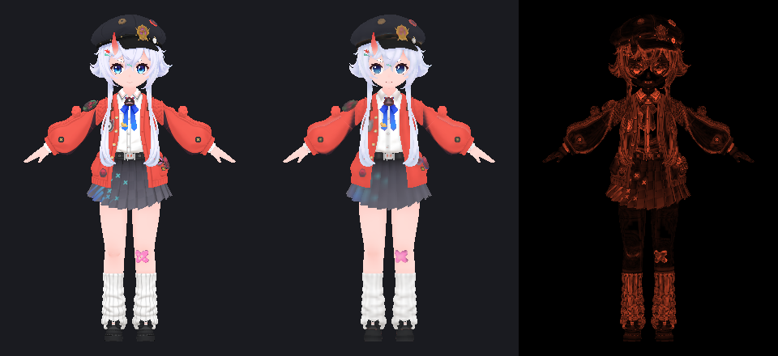
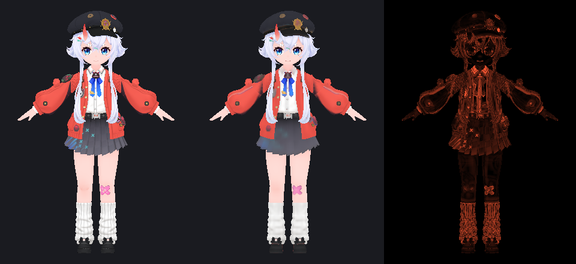
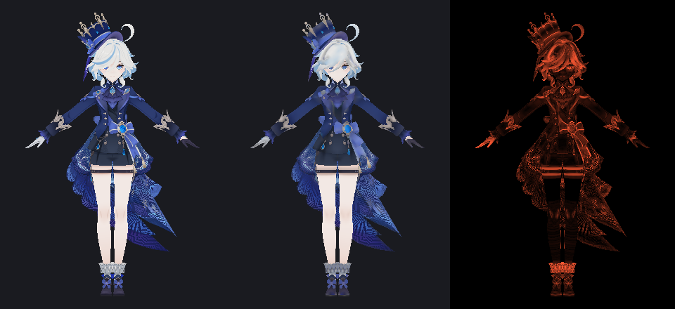
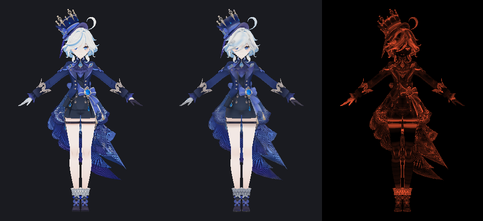

# 第五阶段：真实模型回归与最终评估

> 数据：`data/stage2-parts.md`、`data/stage3-sparse.md`、`.cache/research/views/errors-v3.csv`
> 渲染：`images/`（正面 / 特写，参考 / 候选 / 差异三栏）

## 1. 方法

- 输入：6 个真实角色中的 3 个用于渲染回归（shino、nana、furina），
  部件删除实验覆盖同样 3 个；合成 11 场景用于边界。
- 变体：`baseline-web`（legacy）、`baseline-desktop`（legacy）、
  `A-retention`、`C-retention-cov`（v2 共享核心）。
- 视角：正面 / 侧面 / 背面 / 头部特写；同一正交相机、同一 footprint 过滤。
- 参考图直接采样原始材质，候选图采样 128² 图集；差异图为线性 RGB 平均差。

## 2. 每模型数据

### 2.1 图集与逐材质误差（v2 预算，128²）

| 模型 | 方案 | UV 覆盖 | content | allocated | 逐材质误差 | 正面 | 特写 |
|---|---|---|---|---|---|---|---|
| shino | web | 58.3% | 83.2% | 95.9% | 0.0559 | 0.0275 | 0.0347 |
| shino | desktop | 55.7% | 78.5% | 96.6% | 0.0610 | 0.0285 | 0.0375 |
| shino | A-retention | 58.7% | 84.3% | 97.2% | 0.0587 | 0.0307 | **0.0314** |
| shino | C | **59.8%** | 83.9% | 97.0% | 0.0585 | 0.0280 | 0.0322 |
| nana | web | 50.6% | 75.2% | 94.7% | 0.0445 | 0.0285 | 0.0358 |
| nana | desktop | **54.9%** | 77.9% | 90.3% | **0.0425** | 0.0268 | **0.0324** |
| nana | A-retention | 51.8% | 79.6% | 97.2% | 0.0443 | 0.0305 | 0.0359 |
| nana | C | 52.7% | **79.8%** | **97.8%** | 0.0442 | 0.0307 | 0.0370 |
| furina | web | 40.2% | 75.8% | 96.7% | 0.0888 | 0.0424 | 0.0799 |
| furina | desktop | **52.4%** | 76.8% | 90.4% | **0.0723** | **0.0345** | **0.0610** |
| furina | A-retention | 34.8% | 78.3% | 97.3% | 0.0773 | 0.0413 | 0.0650 |
| furina | C | 38.8% | 77.1% | 96.8% | 0.0805 | 0.0403 | 0.0711 |

### 2.2 三视角平均误差（front/side/back）

| 模型 | web | desktop | A-retention | C |
|---|---|---|---|---|
| shino | **0.0266** | 0.0277 | 0.0301 | 0.0273 |
| nana | **0.0247** | 0.0248 | 0.0276 | 0.0277 |
| furina | 0.0431 | **0.0357** | 0.0431 | 0.0427 |

### 2.3 部件删除（真实几何构造共享材质）

| 模型 | 场景 | 三角面 | 保留部件误差 | 其他材质 texels |
|---|---|---|---|---|
| shino | instance | 69 036 → 55 966 | 0.0585 → 0.0585 | 8 901 → 11 353（+27.6%） |
| shino | uv-region | 69 036 → 55 966 | 0.0583 → 0.0585 | 10 766 → 11 353（+5.5%） |
| nana | instance | 74 426 → 61 443 | 0.0444 → 0.0444 | 9 795 → 11 422（+16.6%） |
| nana | uv-region | 74 426 → 61 443 | 0.0458 → 0.0444 | 11 130 → 11 422（+2.6%） |
| furina | instance | 41 828 → 31 186 | 0.0778 → 0.0778 | 9 481 → 11 153（+17.6%） |
| furina | uv-region | 41 828 → 31 186 | 0.0778 → 0.0778 | 10 740 → 11 153（+3.8%） |

### 2.4 稀疏岛拆分（真实模型）

| 模型 | 方案 | 岛数 | UV 覆盖 | content | 误差 | 复制顶点 |
|---|---|---|---|---|---|---|
| shino | v2 | 43 | 58.7% | 84.3% | 0.0587 | 0 |
| shino | split8 | 88 | 55.6% | 79.7% | 0.0612 | 0 |
| nana | v2 | 73 | 51.8% | 79.6% | 0.0443 | 0 |
| nana | split8 | 136 | 47.1% | 72.5% | 0.0434 | 797 |
| furina | v2 | 81 | 34.8% | 78.3% | 0.0773 | 0 |
| furina | split8 | 212 | 29.4% | 64.6% | 0.0812 | 935 |

## 3. 三类效果必须分开

| 效果 | 观察 | 数值 |
|---|---|---|
| **删除部件的总需求减少** | 三角面精确减少，材质保留 | −13 070 / −12 983 / −10 642 面 |
| **删除后其他材质获得空间** | 其他材质 atlas texels 增加 | +2.6%～+27.6% |
| **UV 组织改变** | 拆分稀疏岛 | 合成 +3.1× 有效像素；真实模型 −3～−5pt 覆盖率 |
| **预算重新分配** | A/C vs 基线 | UV +0～+7pt；面部/眼睛误差 −13%～−89%；整图 +0～+12% 或 −13%（furina） |

**不能把「被删部件从平均值里消失」当成画质提升**：第 2.3 节比较的是
保留部件的端到端采样误差（基本不变），而不是全局平均。

## 4. 正确性

| 检查 | 结果 |
|---|---|
| 几何删除 | 只删除目标 primitive/实例；保留 primitive 的 UV、法线、材质引用不变 |
| 共享材质 | 删除一个部件后材质仍存在并被其他 primitive 引用 |
| 部件 id 稳定性 | 经过 `prepareStaticModel` 后 id 不变（单测） |
| 顶点重映射 | 真实模型 0 个 UV 越界；共享顶点四边形回归测试通过 |
| 共享矩形 | 只有逐三角形 UV 逐位相同才共享；两个不同内部映射的四边形不共享（单测） |
| 图集矩形一致性 | 桌面适配器与研究报告 43/43、81/81 相同 |
| 拆分采样 | 切分不改变源采样点；误差无异常跳变 |
| 全量测试 | 353 个测试通过（72 文件），两套类型检查通过 |

## 5. 性能

| 项目 | 数值 |
|---|---|
| legacy 完整转换（128²） | 302～602 ms，峰值 RSS 287～604 MB（v2 基准） |
| 预算模式完整转换 | shino 512 ms / furina 539 ms（含绘制与编码） |
| 预算规划（纯规划） | 26～264 ms（6 个模型） |
| 拆分 8 块 | 205～560 ms（+1.4～3.5×），另需复制 0～935 顶点 |
| 部件过滤 | 只重建 batch 数组；无额外解码 |

## 6. 哪些成功，哪些失败

**成功**

1. 部件与材质解耦：primitive/实例级 id 贯穿 prepare、减面、图集；
   删除共享材质的部件不再误删保留几何。
2. 删除后需求回收：其他材质获得 2.6%～27.6% 的 atlas texels，保留部件不失真。
3. 共享正确性：修复了「同盒不同内部 UV」的错误共享，并有复现测试。
4. 统计补齐：预算模式现在有逐材质/逐部件、去重后的真实数字。
5. 两端同构：桌面与网页共享分析、预算、共享决策与装箱；矩形逐项一致。

**失败 / 保留为原型**

1. **稀疏岛自动拆分**：合成场景收益明显（3.8%→11.9% 覆盖，误差 −12%），
   但真实模型岛数 +30%～160%、content −3～−14pt、覆盖 −3～−5pt、
   误差 +0～5%、复制 343～935 顶点、耗时 ×1.4～3.5。
   **默认关闭，不集成。**
2. **严格合并**（不切分）降低 content 到 59%～61%，不可用。
3. **默认视觉质量仍不如 legacy**：三视角平均误差在 shino/nana 上
   A/C 低于 web；仅 furina 由 desktop 明显领先；retention 的价值在细节
   材质与可控制性，而不是整图平均。
4. **权重仍按名称传入桌面 API**：同名材质会共享权重，UI 前必须统一。

## 7. 集成状态

| 能力 | 状态 |
|---|---|
| 共享核心（分析/预算/共享/装箱/重映射/统计） | 已集成，可选模式 |
| 桌面预算模式 + 逐材质/部件统计 | 已集成 |
| 网页预算规划（`planAtlas` options） | 已集成，可选 |
| 部件筛选（桌面 `filterParts`） | 已集成（程序接口） |
| 部件筛选（网页 `includedParts`） | 已集成（程序接口，未接 UI） |
| 稀疏岛拆分 | 实验原型，默认关闭 |
| Legacy 默认 | 保持不变 |

## 8. 是否可以进入 UI / 产品化

**可以进入「UI 原型」阶段，但不应该直接切换默认算法。**

前置条件（建议按顺序）：

1. 统一材质 id：桌面 `materialWeights` 改为 `m:{name}#{occ}`，
   网页权重不再依赖 `material.uuid`；
2. UI 只暴露：部件勾选、材质纹理密度倍数、预算目标、floor 提示；
3. 用 5～10 个真实模型验证用户能理解「相对倍数 + 固定预算」；
4. 补 `sampledUtilization`（alpha>0）与网页端同口径报告；
5. 再决定是否把预算模式设为默认。

## 9. 历史代码与重复逻辑

**未来可删除（在预算模式成为默认后）**

- `src/texture-optimizer.ts` compact 分支的 crop / 整 tile / 跨材质分组逻辑；
- `webapp/engine/atlas.ts` 的 legacy `chartsFor` / `packBoxes` / 规划循环；
- `scripts/research/atlas/baseline-web.ts` 与 `baseline-desktop.ts`
  （仅用于对照测试，可移到测试夹具）。

**必须保留**

- `src/texture-chart-math.ts`：岛拆分、合并、wrap 采样、unwrap；
- `src/texture-pixels.ts`：颜色/alpha 烘焙；
- `src/atlas-core/*`：新核心；
- `src/parts.ts` / `webapp/engine/parts.ts`：部件身份与过滤；
- legacy 路径直到新默认经过验证。

## 10. 结论

- 本轮解决的是**底层正确性与可解释性**：部件独立、需求回收、共享安全、
  统计可验证，而不是继续微调权重。
- 稀疏切分的负面结果已保留；没有为了指标强行集成。
- 新架构已具备 UI 原型的基础，但默认算法切换仍需用户验证与 id 统一。
